 

**Desenvolvedor full stack.** Java e Spring, React e TypeScript. 
Trabalho no e-commerce da Segala's Alimentos desde 2023, de aprendiz a desenvolvedor.

 

 

### `> stack --list`

  

 

### `> git log --stats`

  

 

  <code>$ exit 0</code> · <a href="https://thiagoHenrique19.github.io/portfolio">thiagoHenrique19.github.io/portfolio</a>

